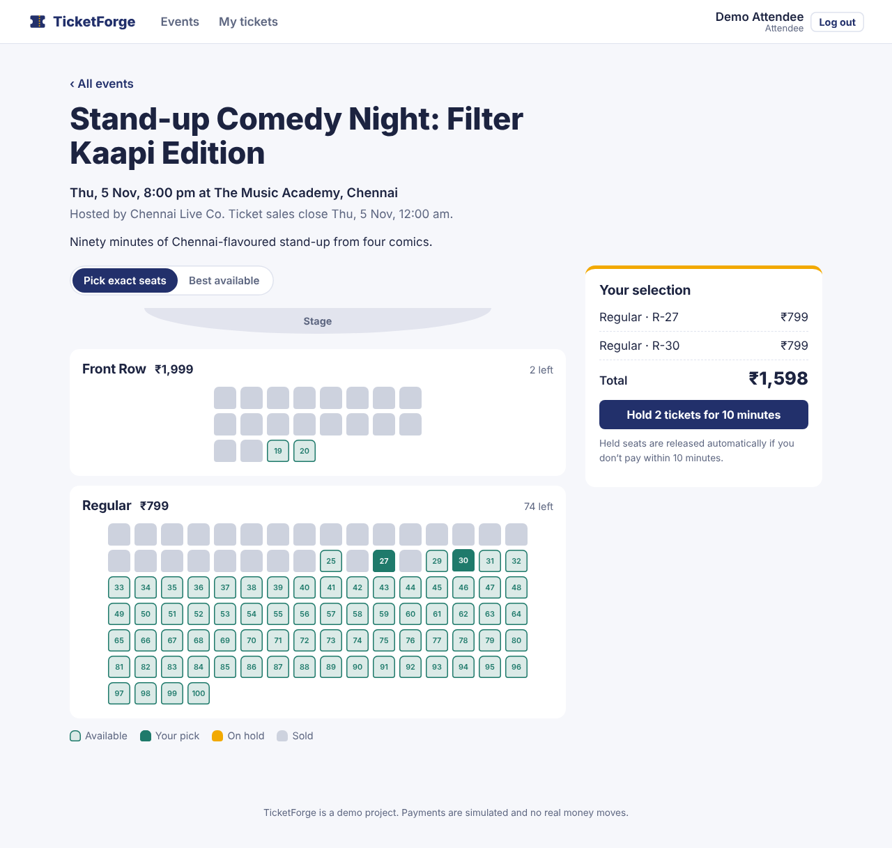
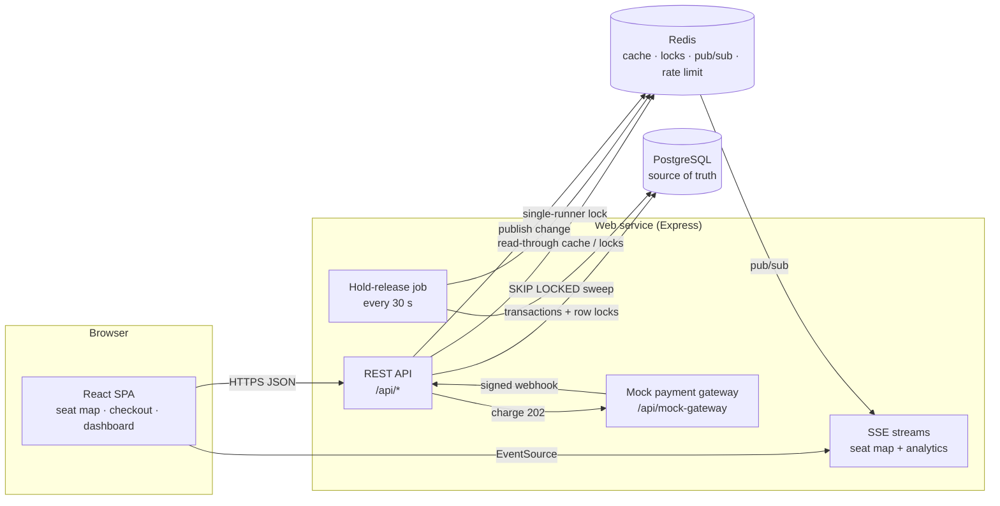
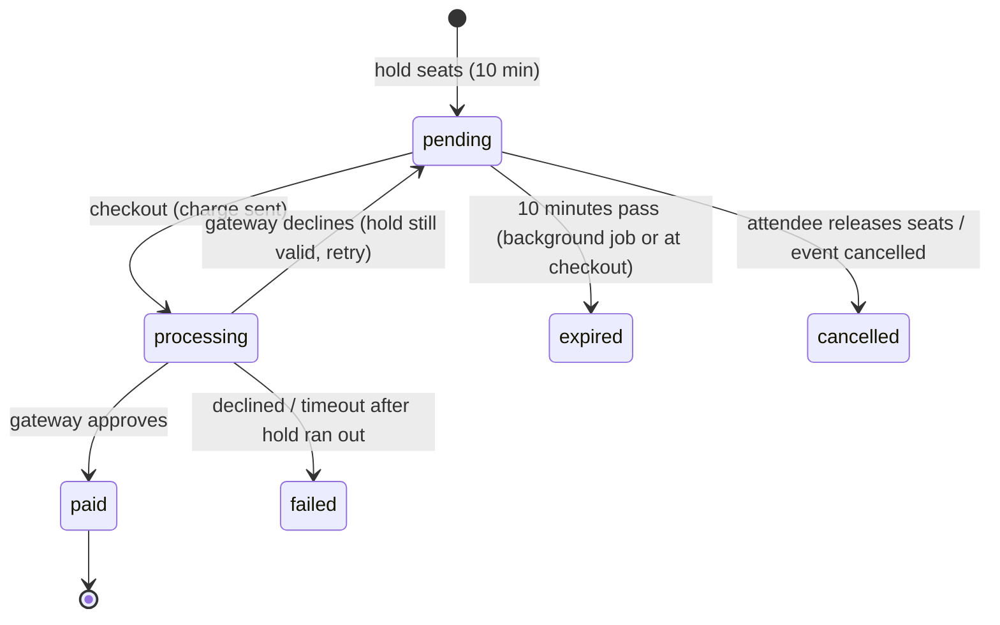
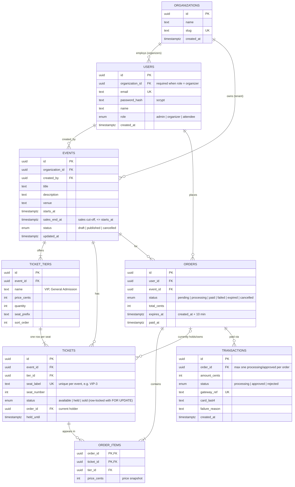
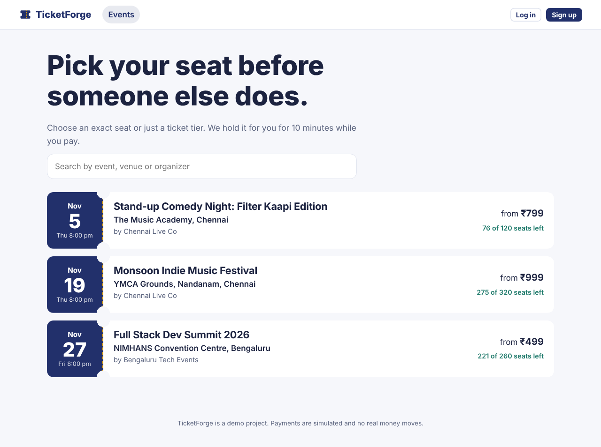
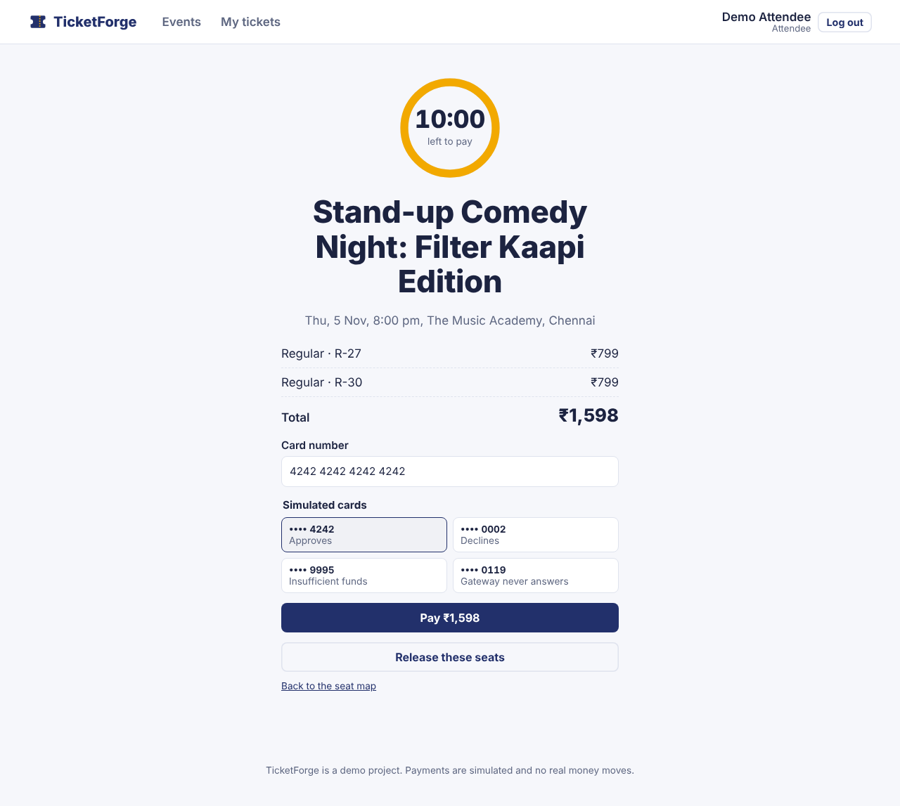
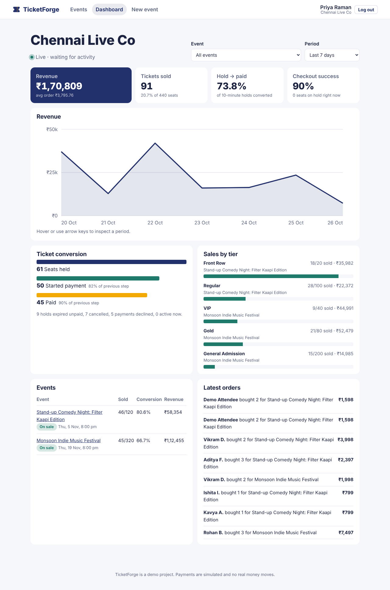

# TicketForge — Multi-Tenant Event & Ticket Reservation System

A full-stack web application where event organizers host events and sell tiered tickets (VIP, Gold, General Admission…), and attendees pick exact seats, hold them for 10 minutes, and pay through an asynchronous mock gateway — **without double-booking, even under concurrent load**.

**Live demo:** `https://<your-app>.onrender.com` ← replace after deploying (see [Deployment](#deployment))

| Role | Email | Password |
|---|---|---|
| Admin | `admin@ticketforge.dev` | `Admin@123` |
| Organizer (Chennai Live Co) | `organizer@ticketforge.dev` | `Organizer@123` |
| Organizer (Bengaluru Tech Events) | `organizer2@ticketforge.dev` | `Organizer@123` |
| Attendee | `attendee@ticketforge.dev` | `Attendee@123` |

The login page also has one-click demo buttons.



---

## Contents

1. [Features](#features)
2. [Tech stack](#tech-stack)
3. [Architecture](#architecture)
4. [How double-booking is prevented](#how-double-booking-is-prevented)
5. [Reservation lifecycle](#reservation-lifecycle)
6. [Caching layer](#caching-layer)
7. [Background job](#background-job)
8. [Mock payment gateway](#mock-payment-gateway)
9. [Data model (ER diagram)](#data-model-er-diagram)
10. [API reference](#api-reference)
11. [Testing: Postman collection & concurrency test](#testing)
12. [Running locally](#running-locally)
13. [Deployment](#deployment)
14. [Project structure](#project-structure)
15. [Design decisions & trade-offs](#design-decisions--trade-offs)

---

## Features

| Requirement | Implementation |
|---|---|
| **RBAC — Admin, Organizer, Attendee** | JWT auth; every request re-reads the user so role changes apply instantly. `requireRole()` guards routes; `assertTenant()` enforces that organizers only touch their own organization's data. |
| **Multi-tenancy** | Each organizer belongs to an `organization` (tenant). Events, analytics and order lists are scoped by `organization_id`; cross-tenant access returns `403`. |
| **Event management** | Organizers create events with up to 8 ticket tiers (name, price, quantity, seat code), a start time and a **sales cut-off**. Draft → publish → unpublish / cancel. Cancelling releases all open holds. |
| **Reservation engine** | Attendees either pick **exact seats** on a live seat map or ask for **N best-available** tickets per tier. Either way the seats go into a **10-minute hold** with a countdown. |
| **Payment simulation** | `/api/mock-gateway/charges` answers `202 Accepted` immediately, then approves/rejects 1.5–3.5 s later via an **HMAC-signed webhook**. Test cards trigger approve / decline / insufficient funds / timeout. |
| **Analytics dashboard** | Revenue over time (24 h / 7 d / 30 d), hold → checkout → paid funnel, conversion rates, sell-through per tier, latest orders. Updates in **real time** via Server-Sent Events. |
| **DB transactions & locks** | `SELECT … FOR UPDATE` (exact seats), `FOR UPDATE SKIP LOCKED` (best available), advisory locks, partial unique index on transactions, Redis lock on checkout. |
| **Caching** | Redis read-through cache for event details (5 min) and seat counts (5 s), invalidated on every write. `X-Cache: HIT/MISS` headers. |
| **Background jobs** | Sweeper runs every 30 s, expires holds older than 10 min and returns seats to inventory; also fails payments the gateway never answered. Redis lock ensures one runner across instances. |

---

## Tech stack

- **Backend:** Node.js 18+, Express 4, PostgreSQL 16 (`pg`), Redis 7 (`ioredis`), Zod validation
- **Frontend:** React 19, bundled with esbuild; hand-built SVG charts (no chart library)
- **Security:** HS256 JWT and scrypt password hashing using Node's built-in `crypto`, Redis-backed rate limiting on auth routes, security headers, HMAC-verified webhooks
- **Infra:** Render (Web Service + Postgres + Key Value) via `render.yaml`; Dockerfile + docker-compose for local runs

---

## Architecture



PostgreSQL is the only source of truth for inventory. Redis makes reads fast and coordinates instances, but **correctness never depends on Redis**: if it goes down, caching and locks degrade gracefully and the database guarantees still prevent overselling.

---

## How double-booking is prevented

Every seat is one row in `tickets`. Creating a hold runs in **one PostgreSQL transaction** (`server/src/services/reservation.js`):

```sql
BEGIN;
-- 1. event must be published and before its sales cut-off
SELECT … FROM events WHERE id = $1 FOR SHARE;

-- 2. one active hold per user per event (stops a user hoarding with parallel requests)
SELECT pg_advisory_xact_lock(hashtext('hold:' || user_id || ':' || event_id));

-- 3a. exact seats: lock exactly those rows, in a fixed order (no deadlocks)
SELECT … FROM tickets WHERE event_id = $1 AND id = ANY($2) ORDER BY id FOR UPDATE;
--     any row not 'available' → ROLLBACK, 409 SEATS_UNAVAILABLE

-- 3b. best available: skip rows other buyers are locking right now
SELECT … FROM tickets WHERE tier_id = $1 AND status = 'available'
 ORDER BY seat_number LIMIT $n FOR UPDATE SKIP LOCKED;
--     fewer than n rows → ROLLBACK, 409 INSUFFICIENT_INVENTORY

INSERT INTO orders (…, expires_at = now() + interval '10 minutes');
UPDATE tickets SET status = 'held', order_id = … WHERE id = ANY(…) AND status = 'available';
--     rowCount must equal seat count (defence in depth)
INSERT INTO order_items …;
COMMIT;
```

**Why it works.** When 30 buyers click the same seat at the same moment, the first transaction takes the row lock; the other 29 block on it. When the first commits, PostgreSQL re-evaluates the row for each waiter under READ COMMITTED, they see `status = 'held'`, and each returns `409`. For General Admission, `SKIP LOCKED` lets concurrent buyers grab *different* free seats instead of queueing.

**Checkout** is protected twice: a Redis lock per order (`SET NX PX`) rejects double-clicks immediately with `409 CHECKOUT_IN_PROGRESS`, and inside the transaction `SELECT … FROM orders … FOR UPDATE` plus a partial unique index (`one processing/approved transaction per order`) make a second charge impossible even if Redis were unavailable.

The concurrency test proves it against a running server:

```
A. 30 buyers -> the same seat V-1, all at once
     results: { '201': 1, '409 SEATS_UNAVAILABLE': 29 }
  PASS  exactly one hold succeeded
B. 29 buyers -> 1 General ticket each (20 in stock), all at once
     results: { '201': 20, '409 INSUFFICIENT_INVENTORY': 9 }
  PASS  every held seat is distinct
C. 8 parallel checkouts of the same order
     results: { '202': 1, '409 CHECKOUT_IN_PROGRESS': 7 }
  PASS  order ends up paid after gateway callback
D. Inventory invariant: capacity = available + held + sold   PASS
```

---

## Reservation lifecycle



Seats follow the order: `available → held → sold`, or back to `available` on expiry, cancellation or failure. A declined card keeps the seats held so the buyer can try another card within the same 10 minutes.

---

## Caching layer

`server/src/services/cache.js` — read-through cache in Redis.

| Key | Content | TTL | Invalidated when |
|---|---|---|---|
| `cache:event:<id>` | title, venue, dates, tier definitions | 300 s | event edited, published, cancelled |
| `cache:event:<id>:availability` | available / held / sold per tier | 5 s | every hold, release, sale, expiry |
| `cache:events:published` | public event list | 30 s | any of the above |

`GET /api/events/:id` returns `X-Cache` and `X-Cache-Availability` headers so you can watch hits and misses (the Postman suite asserts the second read is a `HIT`). Hit/miss counters are on `/api/health` and the admin page. The seat map endpoint is intentionally **not** cached: buyers need the live picture.

---

## Background job

`server/src/jobs/releaseHolds.js` runs every `HOLD_SWEEP_SECONDS` (30 s):

1. **Gateway timeouts** — payments stuck in `processing` for more than 2 minutes are marked rejected (`GATEWAY_TIMEOUT`); the order goes back to `pending` if its hold is still valid, otherwise seats are released.
2. **Expired holds** — in batches of 500:
   ```sql
   WITH due AS (SELECT id FROM orders WHERE status = 'pending' AND expires_at <= now()
                ORDER BY expires_at LIMIT 500 FOR UPDATE SKIP LOCKED)
   UPDATE orders SET status = 'expired' FROM due WHERE orders.id = due.id RETURNING …;
   UPDATE tickets SET status = 'available', order_id = NULL WHERE order_id = ANY(…) AND status = 'held';
   ```
   `SKIP LOCKED` means the sweeper never blocks a buyer who is paying for that exact order at that moment.

A Redis lock (`lock:job:release-holds`) makes sure only one instance sweeps at a time when the app is scaled out. By default the job runs inside the web process (works on free hosting); set `RUN_JOBS_IN_WEB=false` and run `npm run worker` to move it into a dedicated worker. Checkout also checks `expires_at` itself, so an expired hold can never be paid even between sweeps. Admins can trigger the job on demand (`POST /api/admin/jobs/release-holds`).

---

## Mock payment gateway

```
Client ──POST /api/orders/:id/checkout──▶ API ──POST /api/mock-gateway/charges──▶ Gateway
   ◀────────── 202 { status: processing } ──     ◀────────── 202 { id: ch_… } ──
   … polls GET /api/orders/:id …                  … 1.5–3.5 s later …
                                           API ◀──POST /api/payments/webhook (X-Gateway-Signature: HMAC-SHA256)──
```

| Card | Result |
|---|---|
| `4242 4242 4242 4242` | Approved |
| `4000 0000 0000 0002` | Rejected: `card_declined` |
| `4000 0000 0000 9995` | Rejected: `insufficient_funds` |
| `4000 0000 0000 0119` | Never answers → job marks it `GATEWAY_TIMEOUT` |
| any other 12–19 digits | 80 % approved, 20 % declined |

The webhook is verified with a constant-time HMAC comparison and is **idempotent**: a repeated callback for a finished transaction is a no-op. An approval that arrives after the order already timed out is recorded as `LATE_APPROVAL_AUTO_REFUNDED` and never sells released seats.

---

## Data model (ER diagram)



Source: [`docs/er-diagram.mmd`](docs/er-diagram.mmd) (Mermaid) · Vector: [`docs/er-diagram.svg`](docs/er-diagram.svg) · DDL: [`server/src/schema.sql`](server/src/schema.sql)

Key constraints:

- `tickets (event_id, seat_label)` unique; `CHECK (status = 'available' OR order_id IS NOT NULL)`
- `users`: `CHECK (role <> 'organizer' OR organization_id IS NOT NULL)`
- `events`: `CHECK (sales_end_at <= starts_at)`
- `transactions`: partial unique index — at most one `processing`/`approved` transaction per order
- `orders (expires_at) WHERE status = 'pending'` partial index makes the sweeper cheap
- Money is stored as integer **paise** (`*_cents`) to avoid floating-point errors

---

## API reference

All responses are JSON. Errors look like `{ "error": { "code": "SEATS_UNAVAILABLE", "message": "…", "details": {…} } }`.

| Method & path | Role | Purpose |
|---|---|---|
| `POST /api/auth/register` | public | Register attendee, or organizer + new organization |
| `POST /api/auth/login` | public | Get a JWT |
| `GET /api/auth/me` | any | Current user |
| `GET /api/events` | public | Published upcoming events (cached) |
| `GET /api/events/:id` | public | Event + tiers + live counts (cached, `X-Cache`) |
| `GET /api/events/:id/seats` | public | Live seat map |
| `GET /api/events/:id/stream` | public | SSE: seat-map changes |
| `POST /api/events` | organizer | Create event with tiers |
| `PATCH /api/events/:id` | organizer (own) / admin | Edit details; tiers only before any orders |
| `POST /api/events/:id/publish` · `/unpublish` · `/cancel` | organizer (own) / admin | Change status |
| `POST /api/events/:id/holds` | attendee | `{ticketIds:[…]}` or `{items:[{tierId,quantity}]}` → 10-min hold |
| `GET /api/orders` · `GET /api/orders/:id` | attendee | My orders / one order |
| `DELETE /api/orders/:id/hold` | attendee (own) | Release a hold |
| `POST /api/orders/:id/checkout` | attendee (own) | `{cardNumber}` → `202`, result arrives async |
| `POST /api/payments/webhook` | gateway (HMAC) | Payment verdict |
| `POST /api/mock-gateway/charges` | internal | Fake gateway |
| `GET /api/organizer/analytics?range=24h\|7d\|30d&eventId=` | organizer / admin | Dashboard data |
| `GET /api/organizer/analytics/stream` | organizer / admin | SSE: real-time updates |
| `GET /api/organizer/events/:id/orders` | organizer (own) / admin | Orders for an event |
| `GET /api/admin/stats` · `/users` · `/organizations` · `/events` | admin | Platform views |
| `PATCH /api/admin/users/:id/role` | admin | Change role |
| `POST /api/admin/jobs/release-holds` | admin | Run the sweeper now |
| `POST /api/admin/orders/:id/force-expire` | admin, test hook | Fast-forward a hold (disable with `ENABLE_TEST_ROUTES=false`) |
| `GET /api/health` | public | DB/Redis status, cache stats, last sweep |

---

## Testing

### Postman collection

[`postman/TicketForge.postman_collection.json`](postman/TicketForge.postman_collection.json) — **65 requests, 129 assertions**, organised in folders and designed to run top-to-bottom in the Collection Runner (each request stores ids/tokens for the next):

| Folder | Edge cases covered |
|---|---|
| 1. Auth & sessions | duplicate email (409), organizer without org (400), wrong password (401), missing token (401), tampered/invalid token (401 `INVALID_TOKEN`) |
| 2. Event management | attendee creating events (403), sales cut-off after start (400), **cross-tenant edit (403)**, Redis `X-Cache: HIT` after first read, drafts hidden (404) |
| 3. Reservation engine | draft event (422), organizer booking (403), ambiguous body (400), >10 tickets (422), same seat taken (409 `SEATS_UNAVAILABLE`), second hold (409 `ACTIVE_HOLD_EXISTS`), **8 buyers racing for 1 seat → exactly 1 wins**, **12 buyers racing for 10 GA seats → exactly 10 distinct seats** |
| 4. Checkout & payments | paying someone else's order (404), bad card (400), declined card async → hold kept, **double checkout while processing (409)**, retry → paid, pay twice (409 `ALREADY_PAID`), forged webhook (401) |
| 5. **Expired sessions** | hold fast-forwarded past 10 min → checkout `410 HOLD_EXPIRED`, seat back on sale, background job expires holds, cancel releases seats |
| 6. Analytics | revenue/conversion/funnel figures, per-event scope, cross-tenant analytics (403), attendee (403) |
| 7. Admin | stats, users, tenants, RBAC (403), self-demotion blocked (409) |

The concurrency tests fire genuinely parallel requests with `pm.sendRequest` inside the test script.

**Run it:**

- Postman: *Import* the collection (and optionally `postman/TicketForge.deployed.postman_environment.json`), set `baseUrl` to your deployment, *Run collection*.
- CLI (no install needed): `npm run test:postman` or `node scripts/run-postman.js postman/TicketForge.postman_collection.json --base-url https://<your-app>.onrender.com`
- Newman also works: `npx newman run postman/TicketForge.postman_collection.json --env-var baseUrl=https://<your-app>.onrender.com`

The collection is generated from [`scripts/build-postman.js`](scripts/build-postman.js); edit that and run `node scripts/build-postman.js` to regenerate.

### Concurrency stress test

```bash
npm run test:concurrency                                  # local
BASE_URL=https://<your-app>.onrender.com BUYERS=50 node scripts/concurrency-test.js
```

---

## Running locally

**Option A — Docker (easiest)**

```bash
docker compose up --build
# open http://localhost:4000
```

**Option B — your own Postgres + Redis**

```bash
# Prerequisites: Node 18+, PostgreSQL 14+, Redis 6+
createdb tickets
cp .env.example .env          # adjust DATABASE_URL / REDIS_URL if needed
npm install
npm run build                 # builds the React app into client/dist
npm start                     # migrates, seeds demo data on first boot, serves on :4000
```

Then `npm test` runs the Postman suite and the concurrency test against `http://localhost:4000`.

Useful scripts: `npm run dev` (auto-restart API), `npm run dev --prefix client` (rebuild UI on change), `node server/src/seed.js --reset` (wipe and reseed demo data), `npm run worker` (standalone hold sweeper).

---

## Deployment

### Render (one click with the Blueprint)

1. Push this repository to GitHub.
2. In Render: **New → Blueprint**, select the repo. `render.yaml` creates:
   - `ticketforge` web service (Node, free) — build `npm install && npm run build`, start `npm start`, health check `/api/health`
   - `ticketforge-db` PostgreSQL (free)
   - `ticketforge-redis` Key Value / Redis (free, private network only)
   - `JWT_SECRET` and `GATEWAY_WEBHOOK_SECRET` are generated automatically
3. Wait for the first deploy. On boot the app runs migrations and seeds demo data, so you can log in straight away with the accounts above.
4. Copy the URL (`https://ticketforge-xxxx.onrender.com`) into the top of this README and into the Postman environment.

> Free Render web services sleep after inactivity; the first request may take ~30–50 s to wake up. The free Postgres instance expires after Render's free-tier period, so re-create it if needed.

### Railway / others

Any host that runs Node with a Postgres and a Redis works: set `DATABASE_URL`, `REDIS_URL`, `JWT_SECRET`, `GATEWAY_WEBHOOK_SECRET` (and `DATABASE_SSL=true` if your Postgres requires TLS), build with `npm install && npm run build`, start with `npm start`. A `Dockerfile` is included.

---

## Project structure

```
├── server/src
│   ├── server.js            boot: migrate → seed → listen → start job
│   ├── app.js               Express app, middleware, routes, error mapping
│   ├── schema.sql           tables, enums, constraints, indexes (idempotent)
│   ├── seed.js              demo tenants, users, events, a week of orders
│   ├── config.js  db.js  redis.js  validate.js  errors.js
│   ├── lib/                 jwt.js (HS256), password.js (scrypt)
│   ├── middleware/          auth.js (JWT, RBAC, tenant guard), http.js (CORS, headers, rate limit)
│   ├── services/
│   │   ├── reservation.js   holds, row locks, release, expiry sweep
│   │   ├── payment.js       checkout + webhook finalisation
│   │   ├── cache.js         Redis read-through cache
│   │   ├── lock.js          Redis distributed lock
│   │   ├── realtime.js      Redis pub/sub → SSE fan-out
│   │   ├── events.js  analytics.js
│   ├── jobs/releaseHolds.js background sweeper
│   └── routes/              auth, events, orders, payments, gateway, organizer, admin
├── client/src               React SPA (pages/, components/charts.jsx, styles.css)
├── postman/                 collection + environment
├── scripts/                 concurrency-test.js, run-postman.js, build-postman.js
├── docs/                    ER diagram (mmd/svg/png), screenshots
├── render.yaml  Dockerfile  docker-compose.yml  .env.example
```

---

## Design decisions & trade-offs

- **Row per seat** instead of a counter per tier. Costs more rows, but gives real seat maps, natural row-level locking and a trivially checkable invariant (`available + held + sold = capacity`). Tiers are capped at 2,000 seats.
- **Pessimistic locking over optimistic retries.** Seat contention is short and hot; `FOR UPDATE` gives a deterministic winner and a clean `409` for everyone else with no retry loops.
- **Hold expiry is enforced in two places** — the sweeper (to free inventory) and at checkout (so payment can never land on an expired hold). The seat map also shows overdue holds as available.
- **A declined payment keeps the hold** so buyers can retry with another card, matching how real checkouts behave.
- **Server-Sent Events over WebSockets** — the dashboard only needs server → client pushes; SSE is simpler and works through proxies. Redis pub/sub fans events out across instances.
- **Integer paise** for money, INR formatting in the UI.
- **Few dependencies.** JWT, password hashing (scrypt), rate limiting and charts are written on Node/browser built-ins; runtime dependencies are just `express`, `pg`, `ioredis` and `zod`.

### Screens

| Events | Checkout | Organizer dashboard |
|---|---|---|
|  |  |  |
